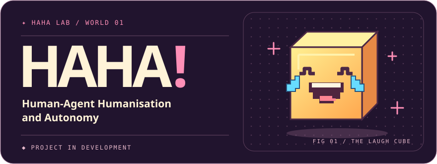
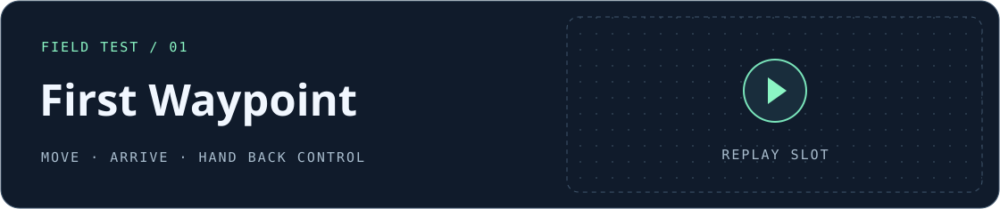

  <picture>
    <source media="(prefers-color-scheme: light)" srcset="assets/hero-light.svg">
    
  </picture>

<strong>A Minecraft agent that plays on its own and moves like a skilled player.</strong>

  <a href="#the-vision">Vision</a> &nbsp; · &nbsp;
  <a href="#first-playtest">Playtest</a> &nbsp; · &nbsp;
  <a href="#whats-next">What’s next</a>

## The vision

  
  

Target: Minecraft Java 26.3 · Fabric · Lightweight client

## First playtest

  

## What’s next

| | |
| :--- | :--- |
| **First build** · Pending | **Benchmarks** · Frame time and memory pending |
| **Replay** · Awaiting first playtest | **Training** · Optional Colab workflow planned |
