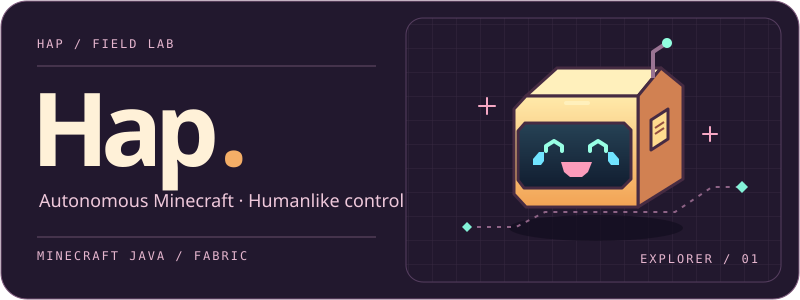

[The project](#the-project) &nbsp; / &nbsp; [First test](#first-test) &nbsp; / &nbsp; [Progress](#progress)

## The project

Hap explores how an autonomous Minecraft player should move, aim, build, and make decisions. The ambition is a capable agent whose actions feel deliberate, with a small enough client to run on modest hardware.

**Movement** — Camera control, footwork, tool changes, and placement timing.  
**Planning** — Gathering resources, choosing tasks, and following longer goals.

## First test

**01 / Reach a waypoint**

A controlled world, one marked destination, and a recorded run. The first test will measure arrival, movement quality, and clean return of control to the player.

Replay and measurements · pending

The recording will appear here after the first playtest, alongside the hardware used, frame-time measurements, and observed failures.

## Progress

| Work | Current stage |
| :--- | :--- |
| Fabric client | Planned |
| First waypoint test | Planned |
| Gameplay recordings | Planned |
| Optional Colab training | Planned |

---

Minecraft Java 26.3 target · Builds planned through GitHub Actions
